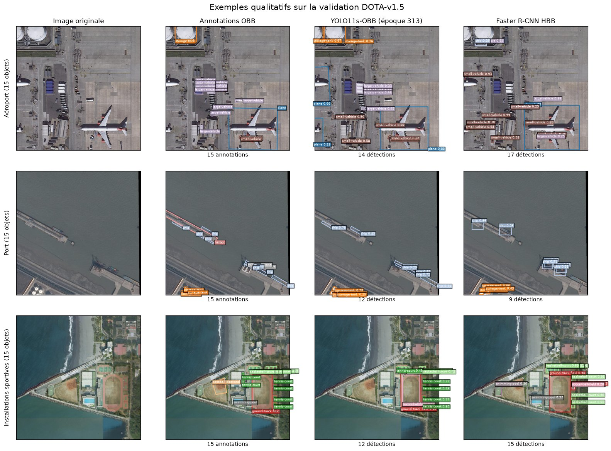
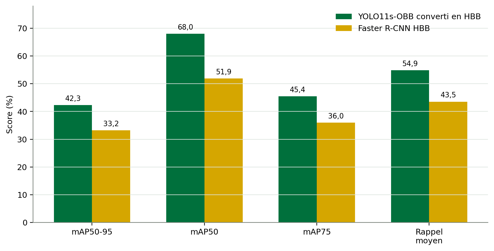
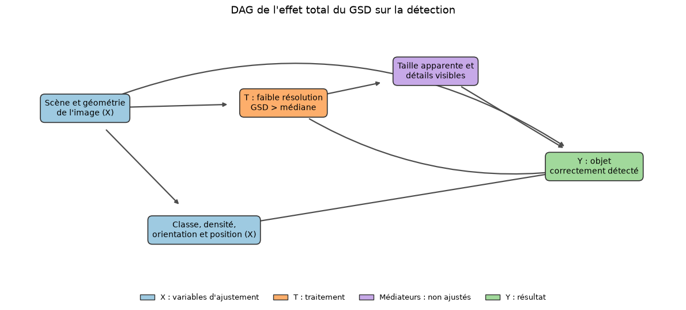
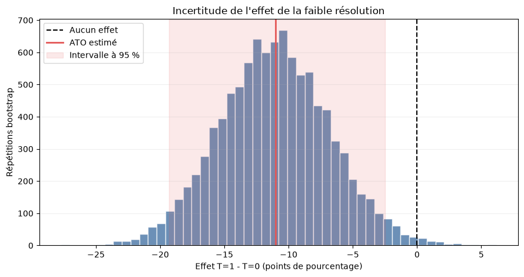

# Aerial Object Detection and Causal Analysis on DOTA

This project detects oriented objects in large aerial images from DOTA-v1.5 with YOLO11s-OBB. It compares the detector with a Faster R-CNN baseline that predicts horizontal boxes. It then estimates the causal effect of spatial resolution (ground sample distance) on the probability that an annotated object is detected. It was built as the capstone project of the bachelor's degree in computer science at UQTR, from June to September 2026.



## Results

Native validation metrics on DOTA-v1.5 (16 classes, 5,086 validation tiles of 1024 x 1024 px):

| Model | Box type | Best epoch | Precision | Recall | mAP50 | mAP50-95 | Images/s |
|---|---|---:|---:|---:|---:|---:|---:|
| YOLO11s-OBB (from COCO) | oriented | 313 | 74.96 | 70.07 | 74.31 | 58.41 | 40.76 |
| Faster R-CNN R50-FPN v2 | horizontal | 12 | n/a | 38.19 | 49.12 | 31.88 | 7.42 |

These two rows are not directly comparable. The YOLO metrics use oriented boxes and rotated IoU, the Faster R-CNN metrics use horizontal boxes and axis-aligned IoU, so a match does not have the same difficulty in both cases.

For a common evaluation, every YOLO oriented box is converted to its enclosing horizontal box, and both models are scored with COCOeval on the same 5,086 tiles (123,901 objects, score threshold 0.001):

| Common HBB evaluation | mAP50-95 | mAP50 | mAP75 | Average recall |
|---|---:|---:|---:|---:|
| YOLO11s-OBB converted to HBB | 42.3 | 68.0 | 45.4 | 54.9 |
| Faster R-CNN | 33.2 | 51.9 | 36.0 | 43.5 |

Throughput and memory were measured on an RTX 4060 (200 validation tiles, 20 warm-up tiles, batch 1, float32). Peak allocated GPU memory is 586 MiB for YOLO and 888 MiB for Faster R-CNN. YOLO has 9.70 M parameters, Faster R-CNN 43.33 M.

Note on checkpoints: the common HBB evaluation, the benchmark and the causal analysis use an earlier YOLO11s-OBB checkpoint from the run transferred from DOTA-v1.0 (epoch 70, 58.37 % native mAP50-95). It was frozen when the causal outcome `Y` was built, so that `Y` stays fixed. The native metrics in the first table come from the final COCO-initialized run (epoch 313). Both checkpoints share the same architecture, so speed and memory are not affected.



## Causal analysis

Question: does a lower spatial resolution reduce the probability that YOLO detects an annotated object?

- Treatment: `T = 1` when the image GSD is above the median of known GSD values (0.2706), `T = 0` otherwise.
- Outcome: `Y = 1` when a prediction of the same class, with confidence >= 0.25 and ProbIoU >= 0.50, is matched one-to-one to the object.
- A logistic regression estimates the propensity score from 25 image-level features (11 numeric summaries and 14 class shares, one class being the reference). Out-of-fold scores are used to check overlap.
- Overlap weights target the ATO. Uncertainty comes from 10,000 bootstrap resamples of the 375 source images.
- Result: in the overlap population, lower resolution reduces detection by 11.01 percentage points (95 % CI [-19.31, -2.48]). After weighting, the maximum SMD is 0.040, measured at the object level on 22 covariates (15 class indicators and 7 object variables).
- A causal forest (econml) does not improve on a constant-effect model (gain -0.40 %, 95 % CI [-1.68, 0.55]), so no reliable heterogeneity is detected.





## Method

- Tiling: 1024 x 1024 tiles with an overlap of 200 px (stride 824). An object is kept in a tile when at least 70 % of its area is visible.
- The train/validation split is fixed at the source image level before tiling, so tiles of one image never cross splits. Causal folds and bootstrap resamples are also grouped by image.
- YOLO11s-OBB: COCO-pretrained `yolo11s.pt`, AdamW (lr0 0.0005), cosine schedule, 55 h budget, 400 epoch ceiling.
- Faster R-CNN ResNet50-FPN v2: COCO weights, new 17-output head, batch 1, AMP, SGD (momentum 0.9). RPN matching is computed in chunks of 32 ground-truth boxes so that dense tiles fit in 8 GB of VRAM.
- A first YOLO run transferred from DOTA-v1.0 reached 58 % mAP50-95 at epoch 63, against epoch 210 when starting from COCO. Both runs reach almost the same maximum, and the final model was trained from COCO so that it does not depend on DOTA-v1.0 annotations.
- Long runs save atomic checkpoints and resume after interruption. `tools/supervise_yolo_training.py` restarts YOLO training automatically after a crash.
- Evaluation scripts check the SHA-256 of the checkpoints before running.

## Repository structure

```
src/        tiling, training, HBB comparison, benchmark and causal outcome scripts
tools/      training supervisor and read-only monitor for YOLO runs
notebooks/  final notebook (French): exploration, preprocessing, models, causal analysis
figures/    figures used in this README
docs/       scientific poster
```

## Running the pipeline

Developed and tested on Windows with Python 3.12 and CUDA 12.6. The DOTA images, annotations and model weights are not distributed. Run every command from the repository root. The training scripts expect the interpreter at `.venv_gpu\Scripts\python.exe`.

```powershell
py -3.12 -m venv .venv_gpu
.\.venv_gpu\Scripts\python.exe -m pip install -r requirements.txt
```

Expected data layout: DOTA images in `Training Data/Images`, `Validation Data/Images` and `Testing Images/Images`, and DOTA-v1.5 label files in `DOTA 1.5/Train` and `DOTA 1.5/Val`.

1. Generate the tiles (`outputs/dota_v15_tiles_1024`):
   ```powershell
   .\.venv_gpu\Scripts\python.exe src\generate_tiles.py --validate-only
   .\.venv_gpu\Scripts\python.exe src\generate_tiles.py
   ```
2. Train YOLO11s-OBB (needs `yolo11s.pt` at the root). The script also requires a hardware profile JSON (`schema_version` 2) in `outputs/yolo_hardware_profiles/<gpu>/hardware_profile.json`. It was generated during development and is not included.
   ```powershell
   .\.venv_gpu\Scripts\python.exe src\train_yolo_obb_v15_clean.py check
   .\.venv_gpu\Scripts\python.exe tools\supervise_yolo_training.py start --expected-gpu "<GPU name>"
   ```
3. Train Faster R-CNN (1 h pilot, then the final run initialized from the pilot):
   ```powershell
   .\.venv_gpu\Scripts\python.exe src\train_faster_rcnn_v15.py start --run-name faster_rcnn_v15_pilot_1h --hours 1 --pilot-train-images 2000 --pilot-val-images 500
   .\.venv_gpu\Scripts\python.exe src\train_faster_rcnn_v15.py start --run-name faster_rcnn_v15_final_72h --hours 72 --epochs 90 --initial-checkpoint outputs\faster_rcnn_runs\faster_rcnn_v15_pilot_1h\checkpoints\best.pt
   ```
4. Common HBB evaluation, benchmark and causal outcome table. The YOLO checkpoint is expected at `outputs/remote_checkpoints/rtx5080_best_v15_current.pt` and its SHA-256 is checked, so other weights require updating the expected hash.
   ```powershell
   .\.venv_gpu\Scripts\python.exe src\compare_yolo_faster_hbb_v15.py run --device 0
   .\.venv_gpu\Scripts\python.exe src\benchmark_yolo_faster_inference_v15.py run --device 0
   .\.venv_gpu\Scripts\python.exe src\build_yolo_causal_outcomes.py run --device 0
   ```
5. Open `notebooks/projet_dota_final.ipynb`. The notebook is written in French and reads the outputs of the previous steps.

## Dataset

DOTA images are distributed under an academic license and are not included in this repository. They can be obtained from the [official DOTA website](https://captain-whu.github.io/DOTA/dataset).

- Xia, G.-S., Bai, X., Ding, J., Zhu, Z., Belongie, S., Luo, J., Datcu, M., Pelillo, M. and Zhang, L. (2018). DOTA: A large-scale dataset for object detection in aerial images. Proceedings of the IEEE Conference on Computer Vision and Pattern Recognition, 3974-3983.
- Ding, J., Xue, N., Xia, G.-S., Bai, X., Yang, W., Yang, M. Y., Belongie, S., Luo, J., Datcu, M., Pelillo, M. and Zhang, L. (2022). Object detection in aerial images: A large-scale benchmark and challenges. IEEE Transactions on Pattern Analysis and Machine Intelligence, 44(11), 7778-7796.

## Context

The project won first place among about 100 students at the UQTR capstone project presentations and was selected for further research toward a scientific publication. Supervision: Prof. Usef Faghihi, UQTR. Poster: [docs/poster.pdf](docs/poster.pdf).

## License

The code is released under the MIT License. The DOTA dataset remains subject to its own license.
